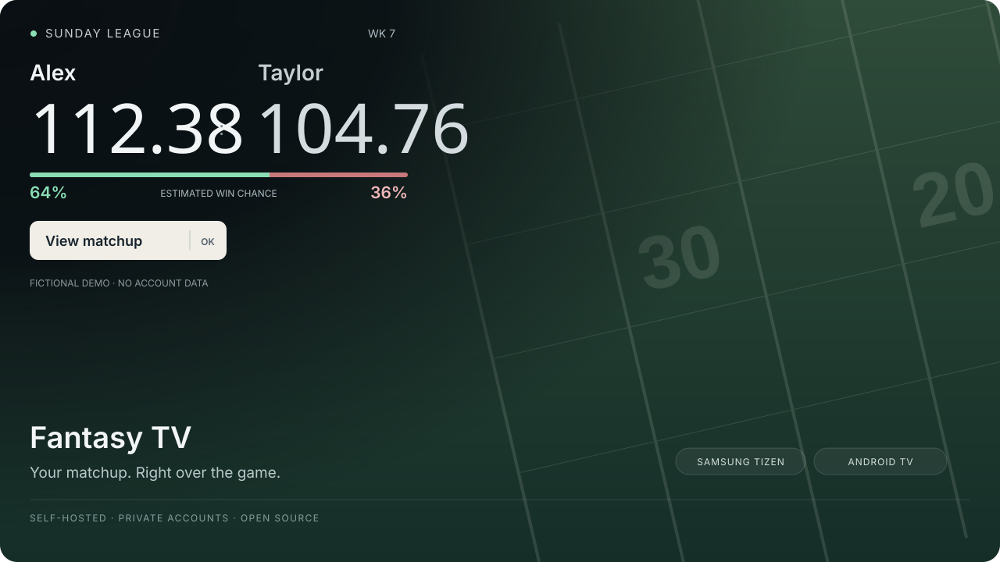

# Fantasy TV

**Your fantasy matchup, right over the game.**



A small corner popup appears for five seconds when either side's actual score changes. Press **OK** for the full starting lineup; press **Back** to return to the game. Manager names, sports typography, green/red win-chance tracks when valid probability data is available, and a soft fade keep the display readable without taking over the screen.

This is a self-hosted, source-first project. Every installation connects its **own** fantasy account and TV. No shared account, hosted household feed, credentials, device addresses, or pairing material are included. The preview above uses synthetic data.

## Start with your agent

Give your Codex agent this repository and the following request:

> Help me set up Fantasy TV from this repository. Read AGENTS.md and the fantasy-tv-setup skill first. Ask which fantasy provider I use, which TV/device I have, and what input I watch. Start with the synthetic demo, help me connect my own league privately, then verify a real cross-app overlay. Do not ask me to paste credentials into chat. Explain any device limitation before making changes.

Or follow [Getting started](docs/GETTING_STARTED.md). The included [setup](.agents/skills/fantasy-tv-setup/SKILL.md) and [verification](.agents/skills/fantasy-tv-verify/SKILL.md) skills give an agent the project-specific workflow and acceptance criteria. They do not grant access to your accounts or devices.

## Choose the TV path

| Path | What is included | Current evidence |
|---|---|---|
| **Samsung Tizen** | Native EFL overlay, remote controls, local companion, temporary-root setup guide | Original implementation physically worked above Apple TV/HDMI on a DU8000 running Tizen 9. Public packaging needs acceptance on each exact model/firmware. |
| **Android TV / Google TV** | Native overlay app, foreground service, private HTTPS feed settings, remote sidebar | Compiled and tested in software; physical device acceptance is still required. Apps/OEMs can suppress overlays, especially on HDMI or protected screens. |
| **Another TV with an Android streaming device** | Use the Android app while watching through that device | The device must permit overlays. It cannot overlay a separate HDMI source or the TV's own apps. |
| **LG/webOS, Roku, Apple TV alone, other inputs** | Architecture and compatibility guidance | No equivalent native renderer included. Do not assume the same result is possible without a supported local compositor. |

See the [full platform matrix](docs/PLATFORMS.md), [Samsung guide](samsung/README.md), [Android TV guide](android-tv/README.md) and [recorded software checks](docs/RELEASE_CHECKS.md). No project can promise system-wide overlays on every TV: the operating system must expose or permit the required display layer.

## Connect your fantasy provider

**[Account and league setup guide →](docs/fantasy-providers.md)**

- **ESPN:** included read-only adapter for public and private football leagues. The guide explains league ID, actual team ID, season, private cookie handling, owner names and matchup verification. ESPN's internal API is undocumented and may change.
- **Sleeper:** included adapter for its documented read-only API. No account password or API token is needed. Set league and roster IDs; prepare the public player catalog once daily.
- **Yahoo and other services:** provider-specific access guidance plus a [common adapter contract](backend/CONTRACT.md). These require an additional implementation using the provider's permitted read access; they are not advertised as working integrations.

The supplied adapters do not invent missing win probabilities. Their bar reads **Unavailable** until a trustworthy provider/adapter supplies a value. The demo illustrates percentages with synthetic values. LIVE describes a mapped player's NFL game, not proof they are on the field. ON TV requires fresh, unambiguous metadata; support varies by player device and app.

## Try it without an account or TV

From the repository root, with Python 3.10+:

```sh
python3 tools/setup.py --demo
python3 -m backend.server --demo
```

In another terminal:

```sh
python3 tools/check_feed.py --demo --endpoint http://127.0.0.1:8787/api/scores --allow-loopback-http
python3 tools/verify.py
```

The loopback-only demo generates synthetic score changes. For an on-screen demo, follow your platform guide. It does not root, install on, or contact a TV automatically.

## Optional pieces

- [Private data backend and Vercel deployment](backend/README.md). Vercel can host the feed; the TV-side renderer and any home companion still need to run.
- [Alexa voice preview](docs/OPTIONAL_INTEGRATIONS.md): create your own private skill and signed relay. Existing shared credentials or the original installation are never reused.
- [Apple TV metadata](samsung/APPLE_TV_CONTEXT.md): local pairing and fresh title matching where the app exposes useful metadata. Automated player-to-channel tuning is not shipped.
- [Architecture](docs/ARCHITECTURE.md), [validation and limitations](docs/VALIDATION.md), [security and privacy](SECURITY.md), [contributing](CONTRIBUTING.md).

## License and credits

Original project source is released under the [Unlicense](LICENSE). The Samsung native renderer derives from [samsung-tv-root](https://github.com/chris-ritsen/samsung-tv-root), also Unlicense; see [NOTICE.md](NOTICE.md). Inter and Bebas Neue retain their SIL Open Font License notices. Samsung, Android, ESPN, Sleeper, Amazon and Apple products remain their owners' trademarks. This project is independent and does not include proprietary TV frameworks, account access or video streams.
