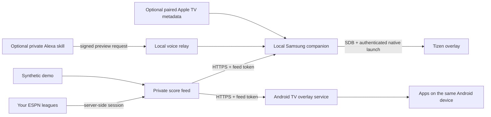

# Architecture

Each installation owns its feed, credentials and TV configuration. The repository contains no shared public league service.

## Feed contract

The [common feed contract](../backend/CONTRACT.md) contains leagues with `me` and `opp` sides, actual scores, available projections and win probabilities, plus starting-player rows. Renderers must not infer a manager's personal name from a team nickname. Use explicit owner/display labels provided by your own configuration or verified account data.

Actual-score changes trigger alerts; projection changes do not. Initial fetches and matchup identity changes establish a quiet baseline. Score corrections count as changes. Missing or stale source data does not advance the baseline. Multiple league changes are presented separately and updates may coalesce while waiting.

Unavailable probabilities must remain unavailable. The bundled real-provider adapters currently leave win probability unavailable; synthetic demo values exercise the visual design. A future provider-supplied or projection-derived percentage needs a documented method and honest label. A green/red bar is not permission to invent odds when the feed has none.

## Samsung process boundary

The companion polls scores, builds a bounded scene and sends a completed state file through the authenticated TV connection. The renderer reads local state and presents a native transparent notification window. It does not contain ESPN credentials or implement a general remote shell API.

The companion heartbeat is part of correctness: the native renderer hides stale state and releases input when its publisher disappears. A successful cloud fetch cannot replace this local transport. The renderer and temporary root also need renewal or recovery after a TV restart.

## Android process boundary

The Android app polls the common feed directly and renders in an application-overlay window. It does not need ESPN session cookies or Samsung root tools. Its private local settings hold the feed address and token. The TV operating system controls overlay permission, foreground-service lifetime and focus behavior.

Android runs on the playback device. Its overlay cannot cross into another HDMI source or another operating system.

## Live player and program context

`LIVE` means the player's NFL game is in progress; it does not prove the athlete is on the field. Known inactive or unavailable data must fail closed. `ON TV` needs fresh, unambiguous program context that identifies both game teams; a generic sports program, multiview or RedZone title cannot establish a unique match.

Apple TV context is optional and app metadata varies. Pairing permits access to a private device identity, so credentials stay local. No game/channel switching is included: launching a video app is not proof that it can tune to the selected player's game.

## Cloud hosting

The feed can be hosted on a private HTTPS service, including Vercel. Credentials and per-installation configuration belong in that service's secret settings. Never deploy a public unprotected mirror of a private league.

Cloud hosting keeps the feed reachable; it does not keep a sleeping home companion or TV renderer alive. A continuously running cloud worker still needs a working, authenticated route to the home device. The repository does not promise a completed cloud-to-TV bootstrap or cold-boot recovery design.

For a computer-independent Samsung setup, an always-on home bridge is the straightforward place for the companion. Validate that bridge's supported SDK, native launcher, network path and recovery before retiring the development computer.
